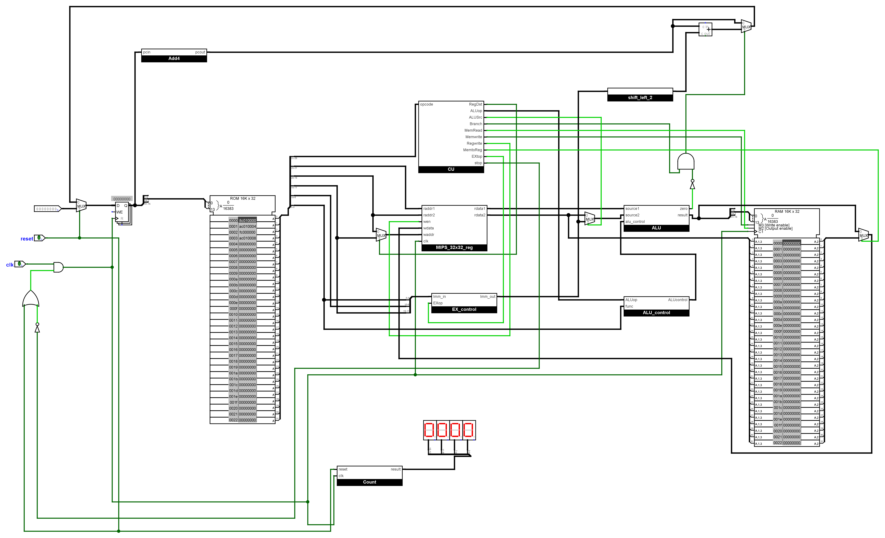

<div align="center">

# 🧩 Logisim MIPS CPU

### 从数字逻辑到五级流水线 MIPS CPU
### From digital logic to a 5-stage pipelined MIPS CPU


</div>

本项目使用 Logisim-evolution 设计了 8 个电路工程，从时序逻辑和数据通路部件，逐步构建单周期与五级流水线 MIPS CPU。

This repository contains eight Logisim-evolution projects, progressing from sequential logic and datapath components to single-cycle and pipelined MIPS CPUs.



## 🧠 项目内容 / What You'll Find

| # | 电路 / Circuit | 核心知识点 / Key Concepts |
|---:|---|---|
| 1 | `2.2-计数器.circ` | Mod-13 counter, carry output, seven-segment display |
| 2 | `2.3-乘法器.circ` | 8-bit shift-and-add multiplier |
| 3 | `3.1-寄存器堆.circ` | 32 × 32 register file, dual read ports |
| 4 | `3.2-存储器.circ` | 64 KB × 32-bit ROM / RAM |
| 5 | `3.3-ALU模块.circ` | 32-bit ALU: arithmetic, logic, compare and shift |
| 6 | `3.4-控制器.circ` | Main control and ALU control |
| 7 | `4.1-单周期CPU.circ` | Single-cycle MIPS datapath |
| 8 | `4.2-流水线CPU.circ` | Five-stage pipeline, forwarding and load-use hazard handling |

## 🚀 快速开始 / Quick Start

1. 安装 **Logisim-evolution 3.9.0**。
2. 打开 `circuits/` 目录中的 `.circ` 文件。
3. 建议从基础模块开始，再依次学习单周期和流水线 CPU。

Install **Logisim-evolution 3.9.0**, open the circuit files in `circuits/`, and explore the component designs before the complete CPU projects.

安装说明：[Logisim 安装及使用说明](docs/Logisim安装及使用说明%20v1.0.docx)

## 📚 指令集 / Supported Instructions

| Instruction | Type | Description |
|---|---|---|
| `addu` | R | Addition |
| `sub` | R | Subtraction |
| `slt` | R | Signed less-than comparison |
| `lui` | I | Load upper immediate |
| `ori` | I | Zero-extended bitwise OR |
| `bne` | I | Branch if not equal |
| `lw` / `sw` | I | Load word / store word |
| `stp` | Custom | Stop PC update |

## 📁 目录结构 / Repository Layout

```text
.
├── circuits/       # Eight Logisim projects
├── docs/           # Design notes, manuals and circuit images
├── scripts/        # Circuit verification scripts
├── tools/          # Logisim setup helpers
├── LICENSE
└── README.md
```

## 📖 详细设计 / Detailed Design

推荐阅读 [详细设计说明](docs/详细设计说明.md)，了解模块设计、引脚定义、控制信号、数据通路、测试程序与验证方法。

Read the [Detailed Design Notes](docs/详细设计说明.md) for module design, pin definitions, control signals, datapaths, test programs, and verification.

## 📄 License / 许可

电路设计部分采用 [MIT License](LICENSE)。

